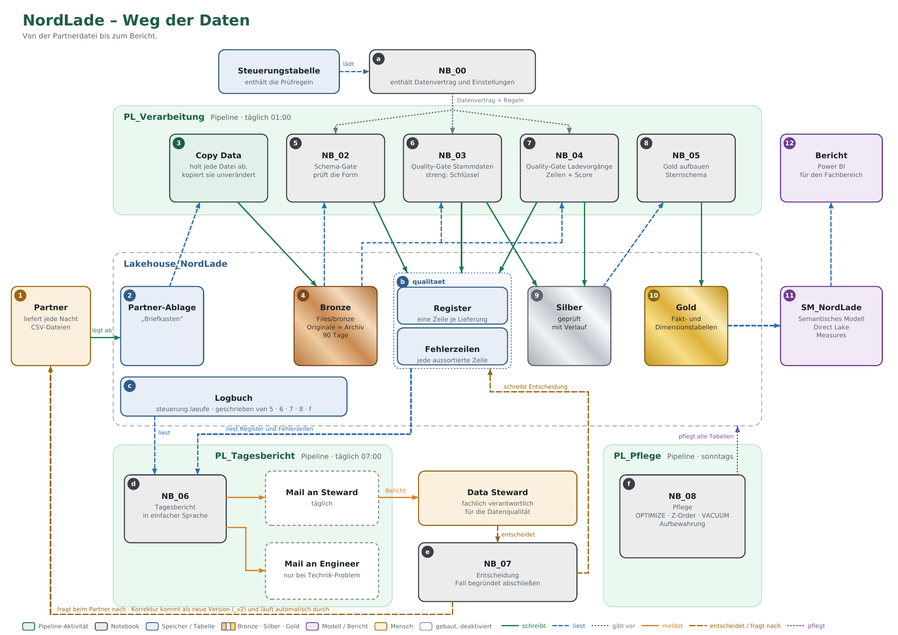

# NordLade – Datenstrecke in Microsoft Fabric

Von der nächtlichen Partnerdatei bis zum Power-BI-Bericht: Batch-Verarbeitung mit Quality-Gates, Regeln als Steuerungstabelle und einem klaren Weg für fehlerhafte Daten.

📄 **[Architektur auf einen Blick (PDF, 5 Seiten)](docs/NordLade_Architektur.pdf)** – Diagramm mit Erklärung jedes Elements, Ablauf, Entscheidungen, Tests.

---

## Worum es geht

NordLade ist ein fiktiver Betreiber von Ladestationen für E-Autos. Ein Partner liefert jede Nacht CSV-Dateien: die Ladevorgänge des Vortags und die Stammdaten (Kunden, Stationen, Tarife).
**Ziel:** ein semantisches Modell für einen Power-BI-Bericht – mit Zahlen, denen man vertrauen kann.

Die Daten sind synthetisch. Gebaut auf einer Fabric-Kapazität F2.

## Was das Projekt zeigt

- **Medallion-Architektur** – Bronze (Originale), Silber (geprüft), Gold (Sternschema)
- **Zwei Gates** – das Schema-Gate prüft die Form der Datei, das Quality-Gate den Inhalt jeder Zeile
- **Regeln als Steuerungstabelle** – 17 Prüfregeln als Daten statt Code; eine neue Regel ist eine neue Zeile, keine Code-Änderung
- **Status statt Löschen** – jede Lieferung und jede aussortierte Zeile bekommt Status und Grund; gelöscht wird nichts
- **Keine Sackgasse** – täglicher Bericht für den Data Steward, Entscheidungs-Notebook zum begründeten Abschließen von Fällen
- **Blindtest** – Testdaten mit versteckten Fehlern aus einer unabhängigen Quelle, damit nicht nur getestet wird, was man selbst erwartet
- **Dev → Prod** – Git-Integration im Entwicklungs-Workspace, Freigabe über eine Deployment Pipeline

## Weg der Daten

1. Der Partner legt CSV-Dateien in die Partner-Ablage.
2. **PL_Verarbeitung** (nachts) kopiert sie unverändert nach Bronze.
3. `NB_02` registriert jede Datei und prüft ihre Form (Schema-Gate).
4. `NB_03` und `NB_04` prüfen den Inhalt mit den Regeln aus der Steuerungstabelle (Quality-Gate). Gute Zeilen kommen per MERGE nach Silber, schlechte werden aussortiert.
5. `NB_05` baut das Sternschema in Gold. Das semantische Modell liest Gold per Direct Lake.
6. **PL_Tagesbericht** (morgens) meldet, was zu tun ist. **PL_Pflege** (sonntags) hält die Tabellen schlank.

## Zentrale Entscheidungen

| Entscheidung | Warum |
|---|---|
| Stammdaten streng, Ladevorgänge mit Score | Ein falscher Schlüssel verfälscht alles, ein falscher Ladevorgang nur sich selbst |
| Prüfregeln in einer Steuerungstabelle | Regeln ändern ohne Code-Änderung; jede Regel wird beim Laden geprüft |
| Korrektur nur als neue Version (`_v2`) | Ein Tag = eine Datei; Korrekturen sind nachvollziehbar und laufen automatisch durch |
| MERGE und Fingerabdruck | Zweimal laden ändert nichts – ein Neustart nach Fehler ist gefahrlos |
| Gold inkrementell (Change Data Feed) | Nur Neues wird verarbeitet – schnell und günstig auf kleiner Kapazität |
| Klare Verantwortung | Der Steward entscheidet über Daten, der Engineer behebt Technik |

## Technik

Microsoft Fabric · Lakehouse · Data Pipelines · PySpark und Spark SQL · Delta Lake (MERGE, SCD 1/2, Change Data Feed, OPTIMIZE, Z-Order, VACUUM) · Direct Lake · Power BI · Git-Integration · Deployment Pipelines

---

Vladimir Kushnir · [LinkedIn](https://www.linkedin.com/in/vladimir-kushnir-802b41106) · [vkushnir.de](https://vkushnir.de)
